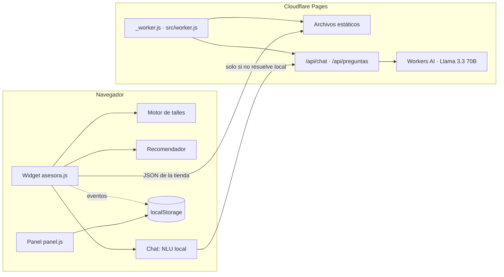

# Asesora Virtual

**Vendedora virtual con IA para tiendas de ropa online.** Calcula el talle de cada prenda sin que el cliente se mida, recomienda productos del catálogo según ocasión, estilo y calce, y responde consultas en lenguaje natural con la información real de la tienda.

**Demo en vivo:** [presentación](https://asesora-virtual.pages.dev) · [tienda de demostración](https://asesora-virtual.pages.dev/tienda) · [panel del negocio](https://asesora-virtual.pages.dev/panel)

   

---

## Contenido

- [El problema](#el-problema)
- [Funcionalidades](#funcionalidades)
- [Arquitectura](#arquitectura)
- [Motor de talles](#motor-de-talles)
- [Chat: resolución en capas](#chat-resolución-en-capas)
- [Generación de preguntas por rubro](#generación-de-preguntas-por-rubro)
- [Panel del negocio](#panel-del-negocio)
- [Seguridad y privacidad](#seguridad-y-privacidad)
- [Modelo de datos de una tienda](#modelo-de-datos-de-una-tienda)
- [Estructura del proyecto](#estructura-del-proyecto)
- [Desarrollo y despliegue](#desarrollo-y-despliegue)
- [Hoja de ruta](#hoja-de-ruta)

---

## El problema

En una tienda física, una vendedora pregunta para qué ocasión es la prenda, cómo le gusta que le quede al cliente y qué talle usa siempre. Online, el cliente está solo frente a una tabla de talles genérica. Eso genera dos costos directos para el comercio:

- **Compras que no se concretan** por la duda del talle.
- **Cambios y devoluciones**, con doble envío, tiempo del equipo y mercadería inmovilizada.

Asesora Virtual reproduce el criterio de una vendedora experta dentro de la tienda online, sin pedirle al cliente que se mida.

## Funcionalidades

| Módulo | Qué hace |
|---|---|
| **Talle sin centímetro** | Estima medidas corporales a partir de altura, peso, morfología y talle habitual, y las ubica en la tabla de talles de cada prenda. Informa el nivel de confianza y explica el cálculo. |
| **Ajuste por calce** | Cruza la preferencia del cliente (al cuerpo, normal, holgado) con el corte de la prenda (slim, regular, oversize) para decidir si conviene subir, bajar o mantener el talle. |
| **Cuestionario de estilo** | Preguntas sobre ocasión, estilo, tipo de prenda, calce y presupuesto. Se generan con IA según el rubro de la tienda. |
| **Recomendación** | Ranking del catálogo por afinidad con las respuestas, filtrado por presupuesto, con armado de look completo y talle calculado en cada prenda. |
| **Chat** | Resuelve en el navegador talles, precios, telas, colores, combinaciones, comparaciones y búsquedas con filtros. Recurre a un LLM solo cuando hace falta, con la información de la tienda y sin inventar datos. |
| **Panel del negocio** | Métricas de uso, distribución de talles, calces y ocasiones, conversión por prenda, insights y preguntas sin responder que, al responderse, la asesora incorpora al instante. |
| **Widget estándar** | Un único script configurable por JSON: el mismo código sirve para cualquier tienda. |

## Arquitectura



**Decisiones principales**

- **Sin frameworks ni proceso de build.** HTML, CSS y JavaScript nativo: carga instantánea, cero dependencias en el cliente y un widget fácil de inyectar en cualquier plataforma de e-commerce.
- **Lógica en el cliente, IA como último recurso.** La mayoría de las consultas se resuelven en el navegador con reglas y el catálogo, sin latencia ni costo. El LLM interviene solo cuando la capa local no alcanza.
- **Edge serverless.** Cloudflare Pages en modo avanzado: un único `_worker.js` sirve los archivos, agrega cabeceras de seguridad y expone la API. Sin base de datos ni servidores que mantener.
- **Configuración por datos.** Cada tienda es un archivo JSON. El widget no conoce la tienda: la lee.

## Motor de talles

`public/js/asesora.js` → `medidas()`, `ubicar()`, `talle()`

1. **Estimación antropométrica.** A partir de la altura y el IMC, se estiman contornos de pecho, cintura y cadera con valores de referencia y coeficientes diferenciados por tipo de tabla (mujer u hombre). La morfología declarada ("más ancha de cadera", "espalda ancha", etc.) aplica correcciones por zona.
2. **Ubicación en la tabla de la prenda.** Cada producto declara su medida determinante (`pecho`, `cintura` o `cadera`). La medida estimada se convierte en una posición continua dentro de la tabla (por ejemplo, 2,4 = entre M y L), detectando si queda fuera de rango.
3. **Fusión con el talle habitual.** Si el cliente indica su talle de siempre, se combina con la estimación (65 % estimación, 35 % talle declarado), lo que corrige el error propio de usar el IMC como aproximación.
4. **Zona de duda.** Si la posición cae en el último 20 % de un talle, se reporta como "entre dos talles" y se elige el mayor, o el menor si el cliente prefiere la prenda al cuerpo.
5. **Matriz de calce.** Preferencia del cliente × corte de la prenda:

   | Preferencia \ Corte | slim | regular | oversize |
   |---|---|---|---|
   | **Al cuerpo** | = | = (sugiere probar uno menos) | −1 |
   | **Normal** | = | = | = (aclara que ya es amplia) |
   | **Holgado** | = (advierte que es al cuerpo) | +1 | = |

6. **Confianza.** Alta si la estimación y el talle habitual coinciden con un margen de un talle; media si no hay talle habitual o difieren; baja si la medida queda fuera de la tabla.

Cada recomendación incluye una explicación en lenguaje natural del cálculo, para que el cliente entienda por qué ese es su talle.

## Chat: resolución en capas

`public/js/asesora.js` → `brain()`, `findProducts()`, `recomendar()`, `sobreProducto()`

| Capa | Dónde corre | Resuelve |
|---|---|---|
| 1. **NLU por reglas** | Navegador | Detección de intención (talle, precio, tela, color, calce, combinar, comparar, stock, búsqueda) y resolución de la prenda mencionada por nombre propio o por tipo, con alias ("hoodie" → buzo) y tolerancia a errores de tipeo (distancia de Levenshtein). |
| 2. **Búsqueda con filtros** | Navegador | Extrae categoría, calce, ocasión, estilo, destinatario, presupuesto ("hasta 30 mil") y clima, y rankea el catálogo. Si un filtro no tiene resultados en ese tipo de prenda, lo informa y ofrece la alternativa más cercana. |
| 3. **Preguntas frecuentes** | Navegador | Coincidencia por tokens con *stemming*, sinónimos y tolerancia a errores de tipeo sobre la base de respuestas de la tienda, incluidas las que el dueño carga desde el panel. |
| 4. **LLM con contexto** | Servidor | Llama 3.3 70B (Workers AI) con el catálogo completo, las preguntas frecuentes y los últimos 6 mensajes. Respuesta restringida a la información provista; si no puede deducirla devuelve un centinela (`NO_SE`) y no se muestra nada inventado. |
| 5. **Derivación** | — | WhatsApp, con sugerencias de preguntas para continuar la conversación. |

**Memoria de contexto:** la última prenda mencionada queda como referencia para preguntas de seguimiento ("¿y viene en negro?", "¿con qué lo combino?"). Las preguntas que incluyen filtros nuevos inician una búsqueda nueva en lugar de heredar el contexto.

## Generación de preguntas por rubro

`src/ai.js` → `generateQuestions()`

- **Salida estructurada:** `response_format` con JSON Schema (`foco` + `preguntas[]`).
- **Prompt con criterio comercial:** instrucciones para identificar qué decide la compra en ese rubro, descartar preguntas que no cambian la recomendación y usar el vocabulario propio del rubro, más un ejemplo (*few-shot*).
- **Validación y saneamiento en el servidor:** se descartan estructuras inválidas, se limitan las longitudes, se eliminan caracteres de marcado, se normaliza el voseo rioplatense y se quitan montos inventados.
- **Fallback local:** si la IA no responde, el cliente usa plantillas por rubro, para que la demo nunca quede vacía.

## Panel del negocio

`public/panel.html`, `public/js/panel.js`

- **Datos:** serie de ejemplo determinística (PRNG con semilla, para que los números sean estables entre visitas) combinada con la actividad real del visitante en la tienda demo, que el widget registra en `localStorage`.
- **Tiempo real:** sincronización entre pestañas mediante el evento `storage`; las acciones en la tienda aparecen en el panel sin recargar.
- **Ciclo de aprendizaje:** las preguntas que la asesora no supo responder aparecen en el panel; al responderlas, la respuesta se incorpora a la base de conocimiento del chat.
- **Visualización propia en SVG:** serie temporal con crosshair, columnas y barras horizontales, con tooltips accesibles por teclado y texto insertado con `textContent`.
- **Insights:** reglas sobre los mismos datos (oportunidades de catálogo, concentración de talles, preguntas frecuentes sin respuesta).

## Seguridad y privacidad

| Medida | Implementación |
|---|---|
| Content Security Policy | `script-src 'self'`, sin scripts en línea: toda la interacción usa delegación de eventos (`data-act`) |
| Cabeceras | HSTS, `X-Frame-Options: DENY`, `frame-ancestors 'none'`, `nosniff`, COOP, `Permissions-Policy` restrictiva |
| CSRF | Las peticiones que modifican datos deben venir del mismo origen |
| Validación | Límite de tamaño de cuerpo, limpieza de caracteres de control y longitudes máximas en todos los campos |
| Anti-abuso | Límite de 12 consultas por minuto por visitante en los endpoints de IA |
| Inyección en la IA | Reglas de sistema que ignoran instrucciones del usuario para cambiar el rol o las reglas |
| Datos personales | No se solicitan nombre, teléfono, mail ni medidas exactas. Teléfonos y mails escritos en el chat se enmascaran antes de enviarse al modelo |
| Almacenamiento | El perfil de talle y la actividad quedan solo en el dispositivo del visitante |
| XSS | Todo contenido dinámico se escapa antes de insertarse; las respuestas del modelo se renderizan como texto con un subconjunto mínimo de formato |

## Modelo de datos de una tienda

`public/data/tienda-<id>.json`

```jsonc
{
  "tienda": {
    "id": "general", "nombre": "Alma Urbana", "rubro": "indumentaria urbana",
    "asesora": "Sofi", "avatar": "🧡", "cuotas": 3, "envioGratisDesde": 90000,
    "tema": { "bg": "#f6f1ea", "ink": "#2a2420", "accent": "#c4643b" }   // colores del widget
  },
  "preguntas": [                                                         // cuestionario de estilo
    { "id": "ocasion", "t": "¿Para qué ocasión buscás?",
      "o": [{ "v": "trabajo", "e": "💼", "l": "Trabajo u oficina", "s": "Prolijo sin ser formal" }] }
  ],
  "tablas": {                                                            // [talle, desde, hasta] en cm
    "mujer": { "pecho": [["XS", 78, 84], ["S", 84, 90]], "cintura": [], "cadera": [] },
    "hombre": { }
  },
  "productos": [{
    "id": "jean-mom", "n": "Jean mom tiro alto", "p": 52900,
    "cat": "abajo",                       // arriba | abajo | abrigo | vestido
    "para": ["mujer"],                    // tabla de talles que aplica
    "calce": "regular",                   // slim | regular | oversize
    "medida": "cadera",                   // medida que determina el talle
    "lbl": ["36", "38", "40", "42", "44", "46"],   // etiquetas numéricas (opcional)
    "tags": ["diario", "salida", "urbano"],        // valores de las preguntas con los que combina
    "tela": "denim rígido 100% algodón", "colores": ["azul clásico", "negro"],
    "why": "es tiro alto, marca la cintura y es cómodo para todo el día"
  }],
  "faq": [{ "q": "¿Hacen envíos?", "a": "Sí, a todo el país…", "k": "envio llega tarda" }]
}
```

## Estructura del proyecto

```
asesora-virtual/
├── public/                    Sitio estático (salida de Pages)
│   ├── index.html             Presentación comercial
│   ├── tienda.html            Tienda de demostración
│   ├── panel.html             Panel del negocio
│   ├── _worker.js             Entrada de Pages (reexporta src/worker.js)
│   ├── css/                   landing · tienda · asesora (widget) · panel
│   ├── data/                  Configuración de cada tienda (JSON)
│   └── js/
│       ├── asesora.js         Widget: motor de talles, recomendador y chat
│       ├── prendas.js         Ilustraciones SVG parametrizadas por prenda y color
│       ├── panel.js           Métricas, gráficos e insights
│       ├── landing.js         Demo animada y laboratorio de IA
│       ├── tienda.js          Catálogo de la tienda demo
│       └── common.js          Utilidades (escape, API, almacenamiento, eventos)
├── src/
│   ├── worker.js              Enrutamiento, API y cabeceras
│   ├── ai.js                  Prompts, esquemas y validación de la IA
│   └── security.js            CSP, límites de uso, enmascarado y validación
├── wrangler.toml              Configuración de Cloudflare Pages y Workers AI
├── README.md                  Documentación técnica
└── LEEME.md                   Guía de uso
```

## Desarrollo y despliegue

**Requisitos:** Node.js 18 o superior y una cuenta de Cloudflare (plan gratuito).

```bash
npm install
npm run dev          # wrangler pages dev, con Workers AI real
```

Sin instalar dependencias, el sitio funciona en modo demo con cualquier servidor estático (`python -m http.server 8787 --directory public`): todo opera en el navegador y la IA del servidor queda reemplazada por plantillas locales.

**Despliegue:**

```bash
npx wrangler login
npx wrangler pages project create asesora-virtual --production-branch main   # solo la primera vez
npm run deploy
```

**Variables (`wrangler.toml`):**

| Variable | Uso |
|---|---|
| `AI_MODEL` | Modelo del chat (por defecto `@cf/meta/llama-3.3-70b-instruct-fp8-fast`) |
| `AI_MODEL_QUESTIONS` | Modelo para generar preguntas por rubro |

## Hoja de ruta

- [ ] App de Tiendanube: lectura del catálogo por API e inyección automática del widget.
- [ ] Talle por equivalencia con marcas conocidas que el cliente ya usa.
- [ ] Encuesta posterior a la compra ("¿te quedó bien?") para recalibrar el motor de talles por tienda.
- [ ] Look completo con agregado al carrito en un paso.
- [ ] Panel con persistencia en base de datos (Cloudflare D1) y reporte periódico.
- [ ] Carga de tablas de talles desde una foto, con visión por computadora.
- [ ] Lógicas de talle específicas para calzado y corsetería.

---

Desarrollado por **Juan Cruz Carranza** · [GitHub](https://github.com/juancarranza21)

© 2026 Juan Cruz Carranza. Todos los derechos reservados.
